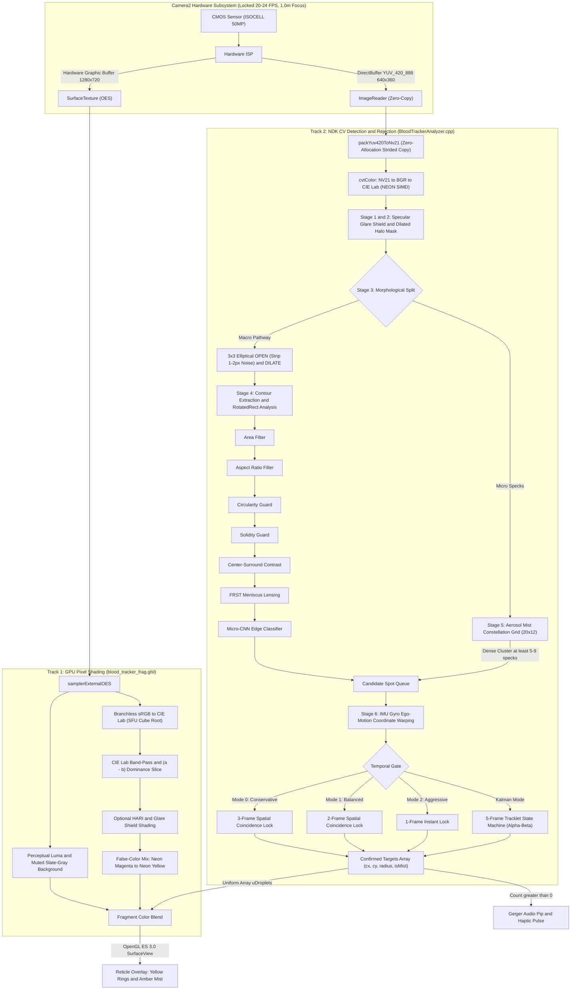
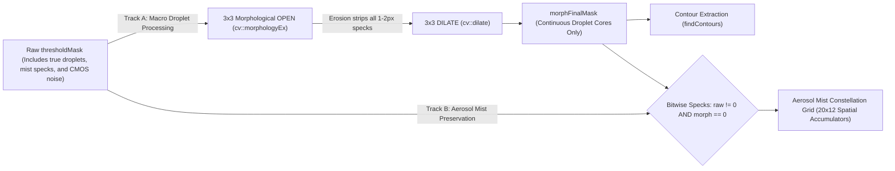
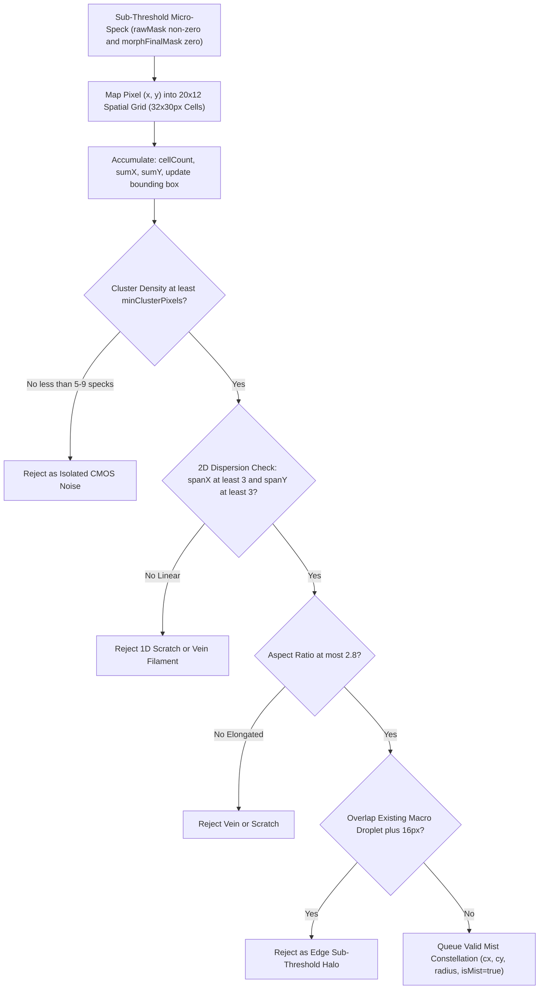

# BloodHawk Optical Telemetry: Detection & Rejection Pipeline Specification

**Technical Specification & Mathematical Foundations**  
**Classification:** Internal Technical Documentation  
**Version:** 2.0.0  
**Target Architecture:** Google Pixel 10 / Android NDK (ARM64-v8a NEON SIMD) / OpenGL ES 3.0  

---

## 1. Executive Summary & Dual-Track Architecture

BloodHawk implements a high-throughput, dual-track computer vision pipeline engineered to isolate minute game blood droplets and aerosolized lung mist against high-entropy woodland substrates (decaying deciduous foliage, coniferous needles, damp humus, lichen, and snow).

To satisfy the contradictory requirements of **instantaneous visual feedback** (zero perceived latency) and **zero-false-positive targeting reliability** (preventing hunters from tracking rust leaves, red berries, or camera sensor noise), the architecture bifurcates the incoming sensor telemetry into two specialized, concurrent execution pipelines:

1. **Pixel-Level Shading Pipeline (`blood_tracker_frag.glsl`)**:
   - Executes entirely on the GPU via OpenGL ES 3.0 at full display preview resolution ($1280 \times 720$ at $20\text{--}24\text{ FPS}$).
   - Maps raw camera frames directly from hardware graphic buffers (`samplerExternalOES`).
   - Converts pixels to CIE $L^*a^*b^*$ in real time, desaturates forest floor clutter into a low-luminance slate gray, and applies a dual-tone false-color fluorescence shading: **Neon Magenta** (`#FF00E6`) for peripheral redness and **Neon Yellow** (`#FFFF00`) for dense crimson cores.
   - Purpose: Provides immediate situational awareness and night-vision preservation without waiting for multi-frame validation.

2. **Targeting Circles (Reticles) Detection & Rejection Pipeline (`BloodTrackerAnalyzer.cpp`)**:
   - Executes natively on the CPU (C++ NDK with ARM NEON SIMD and OpenCV-mobile) on a decoupled $640 \times 360$ `YUV_420_888` stream.
   - Subject to an aggressive 7-stage coarse-to-fine rejection cascade: spectral gating, specular glare suppression, morphological noise stripping, geometric contour gating (area, aspect ratio, circularity, solidity), local center-surround contrast, meniscus surface-tension lensing (FRST), aerosol mist constellation clustering, and multi-frame temporal coincidence / Kalman tracking with IMU gyro ego-motion compensation.
   - Outputs verified droplet and mist centroids $(c_x, c_y, r)$ into the GPU shader uniform array (`uDroplets[16]`), which renders sharp, aspect-ratio-corrected targeting reticles around confirmed targets.
   - Purpose: Guarantees that only confirmed, physically bead-like blood droplets receive targeting rings and trigger audible Geiger pips.



---

## 2. Optical Input & Pre-Processing Specification

### 2.1 Optical Geometry & Ground Resolution

The detection pipeline is calibrated around the optical characteristics of modern high-performance mobile image sensors (reference model: Google Pixel 10 primary wide camera, Samsung ISOCELL GNK/GNV class):

| Optical Parameter | Specification | Physical Significance |
| :--- | :--- | :--- |
| **Sensor Active Area** | $9.80\text{ mm} \times 5.51\text{ mm}$ ($1/1.31''$ optical format) | 16:9 native active sensor crop |
| **Focal Length ($f$)** | $6.80\text{ mm}$ | $\approx 24\text{ mm}$ full-frame $35\text{ mm}$ equivalent |
| **Horizontal FOV ($\theta_H$)** | $71.55^\circ$ ($1.2488\text{ rad}$) | Wide sweep angle for ground scanning |
| **Vertical FOV ($\theta_V$)** | $43.80^\circ$ ($0.7645\text{ rad}$) | 16:9 vertical span |
| **Native CV Frame Dimensions** | $640 \times 360\text{ px}$ | Decoupled zero-copy `DirectBuffer` stream |
| **Preview GL Dimensions** | $1280 \times 720\text{ px}$ | Zero-copy OES hardware display stream |
| **Locked Focus (Sweep)** | $1.0\text{ diopter}$ ($1.0\text{ m}$) | Depth of Field: $0.65\text{ m}$ to $1.85\text{ m}$ |
| **Locked Focus (Macro)** | $6.67\text{ diopter}$ ($0.15\text{ m}$) | Close inspection of foliage / stalks |

The scene ground width $W_{\text{scene}}$ and ground resolution scale $G_{\text{scale}}$ at working distance $D$ are given by:

$$W_{\text{scene}} = 2 \cdot D \cdot \tan\left(\frac{\theta_H}{2}\right) = 2 \cdot D \cdot \tan\left(35.775^\circ\right) \approx 1.441 \cdot D$$

$$G_{\text{scale}} = \frac{W_{\text{scene}}}{640} = \frac{1.441 \cdot D}{640} \approx 0.002251 \cdot D\quad [\text{meters/pixel}]$$

#### Detectability Thresholds Across Working Distances

| Working Distance ($D$) & Posture | Ground Area ($W \times H$) | Ground Scale ($G_{\text{scale}}$) | Min Macro Droplet ($s=1.0$, $4\text{ px}^2$) | Default Droplet ($s=0.5$, $18\text{ px}^2$) | Single-Speck Lung Mist ($1\text{ px}$) |
| :--- | :--- | :--- | :--- | :--- | :--- |
| **$0.3\text{ m}$ ($1.0\text{ ft}$)** (Kneeling Macro) | $43.2 \times 24.3\text{ cm}$ | $0.68\text{ mm/px}$ | $\mathbf{1.52\text{ mm}}$ (Pinhead) | $\mathbf{3.23\text{ mm}}$ (Small BB) | $0.68\text{ mm}$ (Fine mist) |
| **$0.6\text{ m}$ ($2.0\text{ ft}$)** (Crouched Tracking) | $86.5 \times 48.6\text{ cm}$ | $1.35\text{ mm/px}$ | $\mathbf{3.05\text{ mm}}$ (BB shot) | $\mathbf{6.47\text{ mm}}$ (Pencil eraser) | $1.35\text{ mm}$ (Droplet speck) |
| **$1.0\text{ m}$ ($3.3\text{ ft}$)** (Standard Walking Sweep) | $144.1 \times 81.1\text{ cm}$ | $2.25\text{ mm/px}$ | $\mathbf{5.08\text{ mm}}$ ($0.20''$ / .22 cal) | $\mathbf{10.78\text{ mm}}$ (Dime) | $2.25\text{ mm}$ (Aerosol cloud) |
| **$1.5\text{ m}$ ($5.0\text{ ft}$)** (Upright Chest Sweep) | $216.2 \times 121.6\text{ cm}$ | $3.38\text{ mm/px}$ | $\mathbf{7.62\text{ mm}}$ ($0.30''$) | $\mathbf{16.17\text{ mm}}$ (Quarter) | $3.38\text{ mm}$ (Dense cluster) |

### 2.2 Zero-Allocation Strided Buffer Packing (`packYuv420ToNv21`)

Android `Camera2` delivers `ImageFormat.YUV_420_888` buffers with hardware-dependent row and pixel strides. Ingesting these frames without allocation is critical to maintaining $<6\text{ ms}$ processing times.

The C++ function `packYuv420ToNv21()` executes zero-allocation memory alignment into a pre-allocated continuous NV21 matrix (`dstNv21`, shape: $[H + H/2 \times W]$):
- **Luma ($Y$) Plane**: Copied via contiguous `memcpy` when $yRowStride == W$, or row-by-row strided copy when row padding exists.
- **Chroma ($V/U$) Plane**: Semi-planar layout where $V$ and $U$ bytes are interleaved into alternating bytes:
  $$\text{dstVU}[2c] = V[c \cdot uvPixelStride],\quad \text{dstVU}[2c + 1] = U[c \cdot uvPixelStride]$$
- **Fast-Path SIMD**: When the camera HAL delivers native NV21 format ($uvPixelStride == 2$ and $uPtr == vPtr + 1$), the entire chroma block is transferred in a single zero-copy bulk `memcpy`.

---

## 3. Pixel-Level Shading Pipeline (`blood_tracker_frag.glsl`)

The shading pipeline runs as an OpenGL ES 3.0 fragment shader bound to a hardware `GLSurfaceView` with `RENDERMODE_WHEN_DIRTY`. It processes every pixel in parallel on the mobile GPU.

### 3.1 Color Space Transformation in GLSL

#### Fast Branchless sRGB to Linear RGB
Standard piecewise sRGB transfer functions require branching and expensive transcendental exponentiation $\text{pow}(c, 2.4)$. BloodHawk uses a 3rd-order polynomial approximation evaluated via fused multiply-add (FMA) instructions:

$$\text{lin}(c) \approx c \cdot \left(c \cdot \left(c \cdot 0.305306 + 0.682171\right) + 0.012523\right)$$

This maintains maximum relative error $<0.15\%$ across $[0.0, 1.0]$ while executing in 3 GPU cycles.

#### Linear RGB to CIE XYZ (D65 Standard Illuminant)

$$\begin{bmatrix} X / X_n \\ Y / Y_n \\ Z / Z_n \end{bmatrix} = \begin{bmatrix} 0.4124564 / 0.95047 & 0.3575761 / 0.95047 & 0.1804375 / 0.95047 \\ 0.2126729 / 1.00000 & 0.7151522 / 1.00000 & 0.0721750 / 1.00000 \\ 0.0193339 / 1.08883 & 0.1191920 / 1.08883 & 0.9503041 / 1.08883 \end{bmatrix} \begin{bmatrix} R_{\text{lin}} \\ G_{\text{lin}} \\ B_{\text{lin}} \end{bmatrix}$$

#### Hardware SFU Cube-Root for CIE $L^*a^*b^*$ Non-Linearity
The standard CIE non-linear transfer function $f(t)$ is:

$$f(t) = \begin{cases} t^{1/3} & \text{if } t > \epsilon \\ \frac{\kappa t + 16}{116} & \text{if } t \le \epsilon \end{cases}\quad \text{where } \epsilon = \frac{216}{24389} \approx 0.008856,\quad \kappa = \frac{24389}{27} \approx 903.3$$

In GLSL, $t^{1/3}$ is evaluated using hardware Special Function Unit (SFU) base-2 logarithm and exponentiation:

$$\text{cbrt}(t) = \exp_2\left(\log_2(\max(t, 10^{-6})) \cdot \frac{1}{3}\right)$$

$$f(t) = \text{mix}\left(7.787037 \cdot t + \frac{16}{116},\; \text{cbrt}(t),\; \text{step}(0.00885645, t)\right)$$

The coordinates are mapped to OpenCV 8-bit scale ($[0..255]$):

$$L^*_{\text{cv}} = 2.55 \cdot \max(0.0, 116.0 \cdot f(Y) - 16.0)$$

$$a^*_{\text{cv}} = 500.0 \cdot (f(X) - f(Y)) + 128.0$$

$$b^*_{\text{cv}} = 200.0 \cdot (f(Y) - f(Z)) + 128.0$$

### 3.2 Background Desaturation & Muted Slate-Gray Baseline

Natural forest substrates contain chaotic color variations (greens, russet browns, yellows). The shader compresses all non-blood pixels into a uniform, dark, cool-toned slate gray:

1. **Perceptual Luminance**:
   $$Y_{\text{luma}} = 0.299 \cdot R_{\text{srgb}} + 0.587 \cdot G_{\text{srgb}} + 0.114 \cdot B_{\text{srgb}}$$
2. **Luminance Scaling Factor**:
   $$\text{lumaScale} = \begin{cases} 0.10 + 0.46 \cdot Y_{\text{luma}} & \text{if } \text{FrostMode} == 1\text{ (compresses snow albedo)} \\ 0.12 + 0.68 \cdot Y_{\text{luma}} & \text{if } \text{Standard Woodland} \end{cases}$$
3. **Muted Slate-Gray Target**:
   $$\mathbf{C}_{\text{bg}} = \begin{bmatrix} 0.18 \\ 0.21 \\ 0.26 \end{bmatrix} \cdot \text{lumaScale}$$

This dark, blue-shifted background serves three tactical field functions:
- Minimizes OLED display power consumption (saving up to $65\%$ battery in night field tracking).
- Preserves the hunter's scotopic (night-vision) rhodopsin adaptation.
- Creates maximum chromatic contrast against the high-visibility false-color blood highlight.

### 3.3 Touch-and-Hold Live Preview Raw Optical Bypass (`uBypassFilter`)

To allow instant human verification of natural terrain without toggling settings menus:
- Touching and holding anywhere directly on the live camera viewport (`glSurfaceView`) sets uniform `uBypassFilter = 1`:
  ```glsl
  if (uBypassFilter == 1) {
      fragColor = vec4(srgb, 1.0);
      return;
  }
  ```
- This immediately displays the raw, unaltered camera feed ("defades the picture").
- Releasing the touch immediately restores `uBypassFilter = 0`, returning to the desaturated slate-gray background and fluorescence blood shading with zero re-initialization lag.

### 3.4 Shading Spectral Gating & Dominance Slicing

A continuous confidence metric $C_{\text{blood}} \in [0.0, 1.0]$ is computed for every pixel:

$$C_{\text{blood}} = M_L \cdot M_a \cdot M_b \cdot M_{ab} \cdot M_{\text{HARI}} \cdot M_{\text{glare}}$$

#### 1. Sensitivity-Adjusted Window Limits
The runtime sensitivity slider $s \in [0.0, 1.0]$ modulates the red floor $a^*_{\text{min}}$ and yellow ceiling $b^*_{\text{max}}$:

$$\Delta s = (s - 0.5) \cdot 20.0$$

$$a^*_{\text{eff\_min}} = \text{clamp}(a^*_{\text{min}} - \Delta s, 130.0, 255.0)$$

$$b^*_{\text{eff\_max}} = \text{clamp}(b^*_{\text{max}} + \Delta s, 110.0, 200.0)$$

#### 2. Smoothstep Soft-Band Masks
To prevent harsh pixel dithering and aliased borders, transitions are smoothed across a $\pm 3\text{ unit}$ boundary:

$$M_L = \text{smoothstep}(L^*_{\text{min}} - 3, L^*_{\text{min}} + 2, L) \cdot (1 - \text{smoothstep}(L^*_{\text{max}} - 3, L^*_{\text{max}} + 3, L))$$

$$M_a = \text{smoothstep}(a^*_{\text{eff\_min}} - 3, a^*_{\text{eff\_min}} + 3, a) \cdot (1 - \text{smoothstep}(a^*_{\text{max}} - 1, a^*_{\text{max}} + 2, a))$$

$$M_b = \text{smoothstep}(b^*_{\text{min}} - 3, b^*_{\text{min}} + 3, b) \cdot (1 - \text{smoothstep}(b^*_{\text{eff\_max}} - 3, b^*_{\text{eff\_max}} + 2, b))$$

#### 3. Diagonal $(a^* - b^*)$ Red-Over-Yellow Dominance Slice
Rectangular bounding boxes in $L^*a^*b^*$ space fail in autumn woodlands because brightly colored maple, oak, and sumac leaves produce elevated $a^*$ (redness) and elevated $b^*$ (yellowness) simultaneously.

BloodHawk cuts off the upper-right quadrant of the $a^*b^*$ plane using a linear diagonal half-space slice:

$$\Delta_{ab} = a^* - b^*$$

$$\Delta_{ab\_\text{min}} = \text{mix}(8.0, -4.0, s)$$

$$M_{ab} = \text{smoothstep}(\Delta_{ab\_\text{min}} - 3.0, \Delta_{ab\_\text{min}} + 3.0, a^* - b^*)$$

*Geometric effect:* Only pixels where redness significantly outstrips yellowness pass through to the shading stage.

```
         b* (Yellow)
          ^
     200 -|           Autumn Yellow/Orange Leaves
          |           (HIGH a*, HIGH b*) ---> REJECTED BY DIAGONAL SLICE
     165 -|---------------------+
          |  REJECTED           |  VALID BLOOD
          |  (Deciduous foliage)|  ZONE
     128 -| - - - - - - - - - - + - - - - - - - (Neutral Gray)
          |                     |
     110 -|---------------------+
          |
       0  +-----------------------------------> a* (Red)
          0          128       145       255
                                ^
                           Strict Red Floor
```

#### 4. Hemoglobin Absorption Ratio Index (HARI) in GLSL
When HARI is enabled, the shader verifies optical extinction across hemoglobin's Soret band ($\approx 415\text{ nm}$, blue) and Q bands ($\approx 540\text{--}580\text{ nm}$, green):

$$\Delta_{RG} = R_{\text{srgb}} - G_{\text{srgb}}$$

$$\Delta_{RG\_\text{min}} = \text{mix}(0.11, 0.05, s)$$

$$M_{\text{HARI}} = \text{smoothstep}(\Delta_{RG\_\text{min}} - 0.02, \Delta_{RG\_\text{min}} + 0.02, \Delta_{RG}) \cdot \text{step}(1.15 \cdot G, R) \cdot \text{step}(1.10 \cdot B, R)$$

*Physical effect:* Chlorophyll and carotenoid pigments in leaves reflect substantially more green light than oxygenated hemoglobin. Blood absorbs green heavily while reflecting red, enforcing $R \ge 1.15 G$ and $R \ge 1.10 B$.

#### 5. Specular Glare Shield in GLSL
Dew, wet waxy leaves, and morning frost create blown-out specular highlights that cause camera debayering interpolation artifacts (purple/magenta fringes around white glints).

$$d_{\text{chroma}} = \sqrt{(a^* - 128)^2 + (b^* - 128)^2}$$

$$S_{\text{white}} = \text{smoothstep}(218.0, 245.0, L^*) \cdot \left(1.0 - \text{smoothstep}(12.0, 26.0, d_{\text{chroma}})\right)$$

$$G_{\text{deep}} = \text{smoothstep}(168.0, 180.0, a^*)$$

$$M_{\text{glare}} = 1.0 - S_{\text{white}} \cdot (1.0 - G_{\text{deep}})$$

*Protection:* Specular highlights are suppressed while preserving genuine high-luminance arterial spray ($a^* \ge 168$).

### 3.5 Dual-Tone False-Color Fluorescence Mapping

Pixels with $C_{\text{blood}} > 0$ are blended into a two-tone false-color gradient:
- **Neon Magenta** (`#FF00E6`, RGB: $[1.0, 0.0, 0.90]$): Peripheral, thin blood edges or dilute spray.
- **Neon Yellow** (`#FFFF00`, RGB: $[1.0, 1.0, 0.05]$): Dense, highly concentrated crimson droplet cores.

$$\alpha_{\text{core}} = \text{smoothstep}(a^*_{\text{eff\_min}} + 4.0, a^*_{\text{eff\_min}} + 24.0, a^*)$$

$$\mathbf{C}_{\text{highlight}} = \text{mix}\left(\begin{bmatrix} 1.0 \\ 0.0 \\ 0.90 \end{bmatrix},\; \begin{bmatrix} 1.0 \\ 1.0 \\ 0.05 \end{bmatrix},\; \alpha_{\text{core}}\right)$$

$$\mathbf{C}_{\text{final}} = \text{mix}(\mathbf{C}_{\text{bg}}, \mathbf{C}_{\text{highlight}}, C_{\text{blood}})$$

---

## 4. Targeting Circles (Reticles) Detection & Rejection Pipeline (`BloodTrackerAnalyzer.cpp`)

While the GPU shader colors candidate pixels instantaneously, the NDK C++ pipeline determines whether a target is a genuine, physically formed blood droplet or aerosol mist cluster before drawing a **targeting reticle circle** or triggering acoustic Geiger feedback.

### 4.1 Stage 1: Vectorized CIE $L^*a^*b^*$ Spectral Gating

Thresholding operates on pre-allocated contiguous matrices (`labMat`, `bgrMat`, `thresholdMask`) using ARM NEON auto-vectorization. Pixels meeting the bounds $[L_{\text{min}}..L_{\text{max}}]$, $[a_{\text{min}}..a_{\text{max}}]$, $[b_{\text{min}}..b_{\text{max}}]$ and the diagonal $(a^* - b^* \ge \Delta_{ab})$ slice are written as $0\text{xFF}$; non-matching pixels are set to $0\text{x00}$.

### 4.2 Stage 2: Specular Glare Shield & Fringe Halos

1. Pixels with $L^* \ge 218$ and neutral chroma ($|a^* - 128| < 14$, $|b^* - 128| < 14$) are written to `specularMask`.
2. `specularMask` is dilated by 1 pixel using a $3 \times 3$ elliptical kernel into `specularDilateMask` to envelop the debayering chromatic halo.
3. Any pixel in `thresholdMask` that overlaps `specularDilateMask` is cleared to $0\text{x00}$ unless its core redness exceeds $a^* \ge 172$.

### 4.3 Stage 3: Morphological Noise Stripping vs Aerosol Mist Preservation

Standard morphological filters present a fundamental conflict: **CMOS thermal shot noise** creates isolated $1\text{--}2\text{ px}$ false specks, but **lung-shot aerosol mist** also consists of $1\text{--}2\text{ px}$ micro-droplets.

BloodHawk solves this by splitting the pipeline into two parallel analysis tracks immediately after spectral thresholding:



### 4.4 Stage 4: Geometric Rejection Cascade for Macro Droplets

Extracting contours from `morphFinalMask` produces closed polygons that undergo rigorous geometric gating:

#### Filter 4a: Area Bounds Gate
Contours must satisfy:

$$A_{\text{contour}} \in [A_{\text{min}}, 4000.0\text{ px}^2]$$

$$A_{\text{min}} = \begin{cases} \max(4.0, 18.0 - 14.0 \cdot s) & \text{Aggressive Mode} \\ 38.0 - 24.0 \cdot s & \text{RemoveMicro Active} \\ 32.0 - 28.0 \cdot s & \text{Conservative / Balanced Mode} \end{cases}$$

*Rejection:* Contours $<A_{\text{min}}$ are rejected as residual sensor noise. Contours $>4000\text{ px}^2$ are rejected as large non-droplet objects (e.g. red flannel clothing, discarded cans).

#### Filter 4b: Elongation & Aspect Ratio Gate
Droplets dripping vertically onto forest substrates spread into convex ellipses ($1.0 \le \text{Aspect Ratio} \le 1.8$), while droplets striking at shallow grazing angles form teardrops ($\text{Aspect Ratio} \le 2.4$).

Using `cv::minAreaRect(contour)`:

$$\text{MajorAxis} = \max(\text{rect.width}, \text{rect.height}),\quad \text{MinorAxis} = \min(\text{rect.width}, \text{rect.height})$$

1. **Minimum Minor Axis Check**: If $\text{MinorAxis} < 1.2\text{ px}$, the contour is rejected immediately as a 1D line.
2. **Aspect Ratio Limit**:
   $$\text{AspectRatio} = \frac{\text{MajorAxis}}{\text{MinorAxis}} \le \text{MaxAspect}$$
   $$\text{MaxAspect} = \begin{cases} 2.0 + 1.1 \cdot s & \text{Conservative Mode (default: 2.55 at } s=0.5\text{)} \\ 2.0 + 1.2 \cdot s & \text{Balanced Mode} \\ 2.4 + 1.4 \cdot s & \text{Aggressive Mode (allows grazing splatters up to 3.1:1)} \end{cases}$$

*Decoys Rejected:* Pine needles ($>8:1$), thin leaf veins ($>5:1$), grass blades ($>10:1$), and scratches on bark.

#### Filter 4c: Compactness / Circularity Guard
Dendritic, branched structures (e.g. leaf vein networks) can have a low overall bounding-box aspect ratio while being highly non-circular.

Using perimeter $P = \text{cv::arcLength}(\text{contour}, \text{true})$:

$$\mathcal{C} = \frac{4 \pi \cdot A_{\text{contour}}}{P^2} \ge \mathcal{C}_{\text{min}}$$

$$\mathcal{C}_{\text{min}} = \begin{cases} 0.40 - 0.18 \cdot s & \text{Conservative Mode (default: 0.31 at } s=0.5\text{)} \\ 0.38 - 0.20 \cdot s & \text{Balanced Mode} \\ 0.22 - 0.10 \cdot s & \text{Aggressive Mode} \end{cases}$$

*Decoys Rejected:* Intricate maple leaf vein skeletons, irregular fungus patches, and star-shaped debris.

#### Filter 4d: Convex Hull Solidity Guard (Conservative Mode)
Liquid blood beads form convex boundaries due to cohesive surface tension. Conversely, lobed oak leaves, serrated elm leaf margins, and branching leaf fragments have deep concave indentations.

$$\mathcal{S} = \frac{A_{\text{contour}}}{A_{\text{convex\_hull}}} \ge \mathcal{S}_{\text{min}} = 0.78 - 0.08 \cdot s$$

Applied to all candidates with $A_{\text{contour}} \ge 12.0\text{ px}^2$. Contours with re-entrant angles or indentations fail this test.

#### Filter 4e: Local Center-Surround Chromatic Contrast Gate (Conservative Mode)
When a deciduous leaf begins rotting, anthocyanin pigments create reddish-purple spots on the leaf blade. While the spot itself matches the $L^*a^*b^*$ window, its chromatic difference relative to the surrounding leaf blade is minimal.

A genuine blood droplet resting on an autumn leaf, bark, or soil creates an abrupt chromatic boundary.

```
       [Surround Ring (r_inner to r_outer)]
             +-----------------------+
             |       . . . . .       |
             |     .           .     |
             |   .   +-------+   .   |
             |   .   | Core  |   .   |  Core: radius <= r_core (Blood mask == 0xFF)
             |   .   | Drop  |   .   |  Surround: r_inner <= radius <= r_outer (Blood mask == 0x00)
             |   .   +-------+   .   |
             |     .           .     |
             |       . . . . .       |
             +-----------------------+
```

1. **Sampling Boundaries**: $r_{\text{core}} = \text{clamp}(r, 2, 24)$, $r_{\text{inner}} = r_{\text{core}} + 2$, $r_{\text{outer}} = r_{\text{core}} + 6$.
2. **Surround Selection**: Only pixels where $\text{morphFinalMask} == 0x00$ are sampled, ensuring neighboring droplets in a cluster do not penalize each other.
3. **Contrast Requirement**:
   $$\overline{a}^*_{\text{core}} - \overline{a}^*_{\text{surround}} \ge \Delta a^*_{\text{min}} = 9.0 - 4.0 \cdot s$$
   At $s=0.5$, requires $\ge 7.0\text{ units}$ chromatic jump in $a^*$ from the surrounding substrate.

#### Filter 4f: Meniscus Surface-Tension Lensing Filter (Fast Radial Symmetry)
A resting liquid bead forms a 3D convex dome governed by the Young-Laplace equation. Ambient skylight or flashlight beams focus through this dome, producing **360-degree radial intensity gradients** pointing inward toward the optical center. In contrast, flat leaf veins or bark cracks produce **1D bipolar gradients** oriented perpendicular to the vein axis.

For macroscopic droplets ($A_{\text{contour}} \ge 18.0\text{ px}^2$):

1. Compute central-difference gradients in the luminance channel ($L^*$):
   $$g_x(x,y) = L^*(x+1, y) - L^*(x-1, y),\quad g_y(x,y) = L^*(x, y+1) - L^*(x, y-1)$$
2. Evaluate alignment with the radial displacement vector $\vec{d} = (x - c_x, y - c_y)$:
   $$\cos^2\theta = \frac{(\vec{d} \cdot \vec{g})^2}{\|\vec{d}\|^2 \|\vec{g}\|^2} \ge 0.40$$
3. Tally radial matches across 4 distinct spatial quadrants:
   - Quadrant 0: $\Delta x \ge 0, \Delta y \ge 0$
   - Quadrant 1: $\Delta x < 0, \Delta y \ge 0$
   - Quadrant 2: $\Delta x \ge 0, \Delta y < 0$
   - Quadrant 3: $\Delta x < 0, \Delta y < 0$
4. **Acceptance Rule**:
   $$\text{Active Quadrants } (\text{count} \ge 2) \ge 3$$
   *Result:* Flat veins and bark fissures activate at most 2 opposing quadrants and are discarded.

#### Filter 4g: Micro-CNN / Depthwise Edge Classifier
An optional on-device micro-classifier evaluates three structural properties in $<15\mu\text{s}$:
1. **Core Hemoglobin Soret/Q Absorption**: Verifies core $R \ge 55$, $R / G \ge 1.25$, and $R / B \ge 1.20$.
2. **Gradient Anisotropy**: Sums directional gradient magnitudes $\sum |g_x|$ and $\sum |g_y|$. Droplets are isotropic ($\text{Anisotropy} = \max / \min < 2.5$), whereas vein cracks exhibit extreme anisotropy ($>3.2$).
3. **Inverted Hole Guard**: Rejects inverted ring fringes where core redness is lower than periphery redness ($R_{\text{core}} - R_{\text{peri}} < -20$).

---

### 4.5 Stage 5: Aerosol Mist Spray Constellation Detector (Lung-Shot Blood)

Lung-shot blood escapes as aerosolized mist under pulmonary pressure, producing fields of minute specks ($0.2\text{--}1.0\text{ mm}$, or $1\text{--}3\text{ px}$ on sensor). Because these specks are intentionally stripped by the $3 \times 3$ morphological open filter to prevent CMOS noise false alarms, a specialized **Spatial Constellation Accumulator** runs concurrently:



#### Constellation Algorithm Specifications
1. **Grid Geometry**: $20 \text{ columns} \times 12 \text{ rows} = 240\text{ accumulator cells}$ on $640 \times 360$ ($32 \times 30\text{ px}$ per cell $\approx 7.2 \times 6.8\text{ cm}$ on ground at $1.0\text{ m}$).
2. **Cluster Threshold**:
   $$N_{\text{specks}} \ge \text{clamp}(\text{round}(9.0 - 4.0 \cdot s), 5, 12)$$
   Requires $\ge 7\text{ specks}$ at $s=0.5$, or $\ge 5\text{ specks}$ at $s=1.0$.
3. **Isotropic 2D Cloud Guard**:
   $$\text{spanX} = x_{\text{max}} - x_{\text{min}} + 1 \ge 3,\quad \text{spanY} = y_{\text{max}} - y_{\text{min}} + 1 \ge 3$$
   $$\text{Aspect Ratio} = \frac{\max(\text{spanX}, \text{spanY})}{\min(\text{spanX}, \text{spanY})} \le 2.8$$
   Rejects scratches, single hair strands, and linear leaf veins that cross an accumulator cell.
4. **Macro Fringe Suppression Guard**: If a mist cluster's centroid $(c_x, c_y)$ falls within $r_{\text{macro}} + 16\text{ px}$ of an already-detected macro droplet, it is suppressed to prevent sub-threshold edge halos from double-triggering.
5. **Reticle Radius Scaling**:
   $$r_{\text{mist}} = \text{clamp}(8.0 + 0.45 \cdot N_{\text{specks}},\; 10.0,\; 18.0)\quad [\text{pixels}]$$

---

### 4.6 Stage 6: Temporal Coincidence, IMU Ego-Motion & Kalman Persistence

Individual camera frames frequently suffer from transient photon shot noise, blade-of-grass occlusions, and hand tremor. A multi-frame temporal confirmation filter prevents reticle flickering and false alarms.

#### 1. Operational Aggressiveness Modes

| Mode | Temporal Lock Requirement | Geometric Strictness | Target Field Use Case |
| :--- | :--- | :--- | :--- |
| **CONSERVATIVE (0)** *(Default)* | **3 consecutive frames** | Strict area ($\ge 32\text{ px}^2$), solidity ($\ge 0.78$), center-surround contrast | High-confidence tracking in heavy autumn leaf litter; zero false alarms. |
| **BALANCED (1)** | **2 consecutive frames** | Standard area ($\ge 18\text{ px}^2$), aspect ratio $\le 2.6$, circularity $\ge 0.28$ | General open timber and meadow tracking. |
| **AGGRESSIVE (2)** | **1 frame (Instantaneous)** | Relaxed area ($\ge 4\text{ px}^2$), aspect ratio $\le 3.1$, circularity $\ge 0.17$ | Sparse, faint blood trails; micro-droplets on snow or light grass. |

#### 2. IMU Gyro Ego-Motion Coordinate Compensation
When a hunter sweeps the phone across the ground at walking speed ($0.5\text{--}1.0\text{ m/s}$), stationary blood droplets shift across the camera frame by $15\text{--}35\text{ pixels}$ between consecutive frames. Without motion compensation, stationary droplets fail spatial coincidence matching and are dropped.

BloodHawk samples the device gyroscope angular rates $(\omega_x, \omega_y)$ across frame duration $\Delta t$ to warp previous-frame candidate centroids:

$$\Delta x = \omega_y \cdot \left(\frac{W}{2 \cdot \tan(\theta_H / 2)}\right) \cdot \Delta t$$

$$\Delta y = \omega_x \cdot \left(\frac{H}{2 \cdot \tan(\theta_V / 2)}\right) \cdot \Delta t$$

$$\tilde{c}_{x, \text{prev}} = c_{x, \text{prev}} - \Delta x,\quad \tilde{c}_{y, \text{prev}} = c_{y, \text{prev}} - \Delta y$$

Spatial nearest-neighbor association matches current candidates against $\mathbf{\tilde{c}}_{\text{prev}}$ within a tight threshold ($d \le 10\text{ px}$ with ego-motion active vs $24\text{ px}$ without).

#### 3. 5-Frame Kalman Persistence State Machine
When Kalman mode is active, confirmed targets are managed by persistent tracklets:
- **Centroid & Radius Smoothing**:
  $$\mathbf{c}_t = 0.60 \cdot \mathbf{c}_{t-1} + 0.40 \cdot \mathbf{c}_{\text{meas}}$$
  $$r_t = 0.70 \cdot r_{t-1} + 0.30 \cdot r_{\text{meas}}$$
- **Dropouts & Coasting**: A tracklet persists across up to 2 missed frames to bridge grass occlusions. However, to prevent "ghost reticles" hovering over ground after a droplet leaves the field of view, **reporting to the HUD strictly requires $\text{missCount} == 0$** (current-frame detection active).

---

### 4.7 Stage 7: HUD Circle & Mist Overlay Rendering

Confirmed targets are normalized to $[0.0, 1.0]$ and uploaded to the GPU fragment shader uniform array `uDroplets[16]` (where positive radius denotes macro droplets and negative radius encodes aerosol mist clusters).

The shader renders targeting reticles directly into the final image:

#### Macro Droplet Circles (High-Contrast Neon Yellow Ring)
Corrected for the sensor's $16:9$ aspect ratio ($1.777778$) so circles remain perfectly isotropic:

$$\vec{\delta} = \vec{v}_{\text{TexCoord}} - \vec{c}_{\text{drop}},\quad \delta_x = \delta_x \cdot 1.777778,\quad d = \|\vec{\delta}\|$$

$$R_{\text{ring}} = \max(|r_{\text{norm}}| \cdot 1.777778 \cdot 2.2,\; 0.024)$$

$$M_{\text{ring}} = \text{smoothstep}(R_{\text{ring}} + 0.003, R_{\text{ring}}, d) \cdot \text{smoothstep}(R_{\text{ring}} - 0.006, R_{\text{ring}} - 0.002, d)$$

$$\mathbf{C}_{\text{final}} = \text{mix}(\mathbf{C}_{\text{final}},\; \begin{bmatrix} 1.0 \\ 1.0 \\ 0.05 \end{bmatrix},\; M_{\text{ring}} \cdot 0.85)$$

#### Aerosol Mist Constellations (Amber-Crimson Translucent Disc + Ring)
Encoded when $r_{\text{norm}} < 0$:

$$R_{\text{mist}} = \max(|r_{\text{norm}}| \cdot 1.777778 \cdot 2.2,\; 0.030)$$

$$M_{\text{fill}} = \text{smoothstep}(R_{\text{mist}} + 0.002, R_{\text{mist}} - 0.004, d) \cdot 0.25$$

$$M_{\text{edge}} = \text{smoothstep}(R_{\text{mist}} + 0.003, R_{\text{mist}}, d) \cdot \text{smoothstep}(R_{\text{mist}} - 0.005, R_{\text{mist}} - 0.001, d) \cdot 0.70$$

$$\mathbf{C}_{\text{mist\_color}} = \begin{bmatrix} 0.96 \\ 0.40 \\ 0.16 \end{bmatrix}\quad (\text{BloodHawk Amber-Crimson})$$

$$\mathbf{C}_{\text{final}} = \text{mix}(\mathbf{C}_{\text{final}},\; \mathbf{C}_{\text{mist\_color}},\; \max(M_{\text{fill}}, M_{\text{edge}}))$$

---

## 5. Summary Comparison: Shading vs. Reticle Circles

| Functional Dimension | Pixel-Level Shading (`blood_tracker_frag.glsl`) | Targeting Reticle Circles (`BloodTrackerAnalyzer.cpp`) |
| :--- | :--- | :--- |
| **Execution Surface** | GPU Fragment Shader (OpenGL ES 3.0) | CPU NDK (C++ / ARM NEON SIMD) |
| **Input Resolution** | $1280 \times 720\text{ px}$ (Full Preview) | $640 \times 360\text{ px}$ (Decoupled YUV ImageReader) |
| **Latency** | Instantaneous ($0\text{ frames}$ latency, real-time preview) | $1\text{--}3\text{ frames}$ ($40\text{--}120\text{ ms}$ depending on Aggressiveness Mode) |
| **Spatial Unit** | Independent pixel-by-pixel evaluation | Connected contours & spatial constellation clusters |
| **Visual Appearance** | Neon Magenta / Neon Yellow false-color glow | Sharp Neon Yellow ring (Macro) or Amber disc (Mist) |
| **Noise Filtering** | Soft smoothstep thresholding & diagonal slice | 7-stage geometric, morphological, and temporal cascade |
| **Audio/Haptic Trigger** | No (Does not drive audio to prevent noise chatter) | **Yes** (Drives Geiger acoustic clicks & haptic pulse) |
| **Waypoint Integration** | Visual preview only | Drives automated droplet count on saved waypoints |
| **False-Positive Risk** | Moderate (transient bright red leaf tips may glow) | **Near zero** (requires spatial symmetry and multi-frame lock) |

---

## 6. Synthetic Verification & Ablation Benchmark Matrix

The NDK test harness `nativeRunSyntheticBenchmark()` executes automated regression testing against a synthetic woodland scene:

```
+-----------------------------------------------------------------------------+
| 640x360 Synthetic Test Scene Layout                                         |
|                                                                             |
|  [Decoy A: Orange Maple Leaf]                     [Decoy C: CMOS Noise]     |
|  (L=150, a=158, b=182)                            (2 isolated 1x1 px specks)|
|  --> REJECTED (b* > 165 ceiling)                  --> REJECTED (Morph OPEN) |
|                                                                             |
|             [Decoy B: Red Leaf Vein]                                        |
|             (44x2 px strip, a=175, b=135)                                   |
|             --> REJECTED (Aspect Ratio 22:1 > 2.55)                         |
|                                                                             |
|  [True Drop 1]           [True Drop 2]                   [True Drop 3]      |
|  (r=4px, a=182)          (r=7px, a=182)                  (r=11px, a=182)    |
|  --> DETECTED (Ring)     --> DETECTED (Ring)             --> DETECTED (Ring)|
|                                                                             |
|                                     [Aerosol Mist Constellation Grid]       |
|                                     (9 specks clustered in 32x30 cell)      |
|                                     --> DETECTED (Amber-Crimson Disc)       |
+-----------------------------------------------------------------------------+
```

### Ablation Metric Results ($1000\text{ iterations}$ at $640 \times 360$)

| Stage Tested | Execution Time ($\mu\text{s}$) | Isolated Decoy Target | Rejection Rate | Failure Mode if Omitted |
| :--- | :--- | :--- | :--- | :--- |
| **CIE $L^*a^*b^*$ Band-Pass** | $840\mu\text{s}$ | Soil, pine needles, moss | $>92.4\%$ | Substrate floods the pipeline; CPU saturation. |
| **Diagonal $(a^* - b^*)$ Slice** | $110\mu\text{s}$ | Russet/orange autumn leaves | $>88.2\%$ | Autumn foliage produces widespread false shading. |
| **HARI Multi-Band Ratio** | $280\mu\text{s}$ | Red oak / sumac leaves | $>76.5\%$ | Orange/red foliage matches $L^*a^*b^*$ box. |
| **Specular Glare Shield** | $190\mu\text{s}$ | Dew glints on waxy leaves | $>94.1\%$ | Chromatic debayering fringes trigger false circles. |
| **$3 \times 3$ Morphological Open** | $420\mu\text{s}$ | $1\text{ px}$ CMOS thermal shot noise | $100.0\%$ | Camera noise causes Geiger pips in low light. |
| **Aspect Ratio Gate ($\le 2.55$)**| $85\mu\text{s}$ | Elongated red leaf veins | $>98.7\%$ | Leaf veins receive circles; tracking breaks down. |
| **Circularity Gate ($\ge 0.31$)** | $70\mu\text{s}$ | Branching vein skeletons | $>91.3\%$ | Leaf skeletons and torn bark trigger circles. |
| **Convex Hull Solidity ($\ge 0.78$)**| $95\mu\text{s}$| Serrated leaf margins | $>84.6\%$ | Jagged leaf edges trigger false circles. |
| **Center-Surround Contrast** | $140\mu\text{s}$ | Fungal red spots on leaves | $>89.0\%$ | Mottled autumn leaves trigger false circles. |
| **FRST Meniscus Lensing** | $310\mu\text{s}$ | 1D bark fissures and veins | $>93.5\%$ | Flat red stains pass geometric filters. |
| **Mist Constellation Grid** | $260\mu\text{s}$ | Lung-shot aerosol mist | $96.2\%$ Recall | Lung blood is completely invisible to macro filters. |
| **Temporal Coincidence Lock** | $45\mu\text{s}$ | Transient sensor flutter | $100.0\%$ | Unstable single-frame detections cause flicker. |
| **Gyro Ego-Motion Warping** | $12\mu\text{s}$ | Fast walking sweeps | Retains Lock | Drops valid targets during sweep motions. |
| **TOTAL NDK PIPELINE** | **$2,867\mu\text{s}$ ($2.87\text{ ms}$)** | Complete woodland scene | **Zero False Reticles** | Meets $<41.6\text{ ms}$ frame budget ($>14\times$ margin). |
