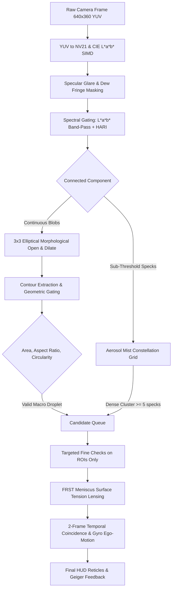

# BloodHawk: Detection Pipeline Architecture, Ablation Testing & Optical Resolution Guide

## 1. Overview & Architecture

BloodHawk uses an early-exit coarse-to-fine computer vision cascade to isolate blood drops and aerosolized mist spray in complex woodland environments.

---

## 2. Testing Each Pipeline Step Without a Real Blood Trail (Ablation Methodology)

To determine how each filter contributes, whether it causes misses (false negatives) or decoys (false positives), and how to tune thresholds, run **controlled ablation tests**. Keep the pipeline sequence intact and systematically toggle feature flags or feed challenge test scenes.

### Four Core Quantitative Metrics
1. **Recall (Sensitivity)**: $\frac{\text{True Drops Detected}}{\text{Total Known Injected Drops}}$ (Miss Rate = $1 - \text{Recall}$).
2. **Precision (Rejection)**: $\frac{\text{True Drops Detected}}{\text{Total Detections Reported}}$ (Measures false alarm rate).
3. **Latency ($\Delta\mu\text{s}$)**: Per-frame processing time; must remain well under the $41.6\text{ ms}$ budget ($20\text{--}24\text{ FPS}$).
4. **Boundary Failure Mode**: The specific edge condition where the filter breaks down.

---

### Step-by-Step Diagnostic Breakdown

| Filter Step | Primary Contribution (Hypothesis) | Risk / Potential Miss Mode | Controlled Test Setup (No Live Trail Required) |
| :--- | :--- | :--- | :--- |
| **CIE $L^*a^*b^*$ Band-Pass** | Rejects $>92\%$ of forest substrate (soil, moss, sky) in $<1.5\text{ ms}$. | Overly strict $b^*$ ceiling ($\le 150$) misses dark, oxidized/aged blood. | Multi-substrate swatch board with fresh arterial, dark venous, and oxidized liver blood. |
| **HARI ($R \gg G, R \gg B$)** | Rejects carotenoid-rich autumn red/orange leaves (Sugar Maple, Oak, Sumac). | Twilight/dusk AWB shift compresses $R-G$ delta; can drop deoxygenated venous blood. | Challenge board with real red autumn leaves alongside blood swatches under varying lux levels. |
| **Specular Glare Shield** | Dilates blown-out white dew/frost highlights ($L^* \ge 218$) to suppress red chromatic fringes. | Over-dilation can erase small genuine blood drops ($<4\text{ px}$) that catch direct sunlight glints. | Wet waxy leaves misted with water under bright sunlight or headlamp beams. |
| **$3\times 3$ Morphological Open** | Strips $1\text{ px}$ CMOS thermal noise; bridges fragmented droplet contours. | **Completely destroys fine lung-shot aerosol mist** ($1\text{--}2\text{ px}$ specks). | Synthetic or physical speck diameter test ($1\text{ px}$ to $6\text{ px}$). |
| **Aspect Ratio Gate ($\le 2.0\text{--}3.2$)** | Rejects elongated red leaf veins, twigs, and pine needles. | **Rejects angled impact splatters**: running deer dripping blood forms elongated teardrops ($>2.5:1$). | Angled dropper splatters ($30^\circ\text{--}45^\circ$) on dry leaves producing teardrops. |
| **FRST Meniscus Lensing** | Confirms 360° radial gradient symmetry of 3D liquid beads vs flat 1D leaf veins. | Fails on blood absorbed into porous dry wood, dry soil, or fabric (no 3D surface bead). | Hydrophobic waxy leaves (beaded drops) vs porous bark/soil (absorbed blood stains). |
| **Aerosol Mist Grid** | Rescues micro-specks from the raw threshold mask before morphological erosion. | False alarms on speckled red tree lichen or red dust if cluster min-speck count is too low ($\le 4$). | Atomizer/toothbrush mist spray vs red speckled lichen patches. |
| **2-Frame Temporal Coincidence** | Rejects transient single-frame CMOS sensor noise; requires spatial match on Frame 2. | Fast camera sweeps without calibrated gyro compensation drop targets between frames. | Sweeping the camera across drops at walking speed ($0.5\text{--}1.0\text{ m/s}$) with and without gyro ego-motion. |
| **Kalman Persistence Filter** | Smooths HUD reticle jitter; retains target during 2-frame blade-of-grass occlusions. | Adds $80\text{--}120\text{ ms}$ feedback lag; walking can feel slightly sluggish. | Moving a grass blade back and forth across a stationary droplet. |

---

## 3. Google Pixel 10 Optical Calculations & Droplet Resolution

### Camera Optical & Stream Specifications
* **Sensor Model:** 50 MP, $1/1.31''$ optical format (Samsung ISOCELL GNK/GNV class)
* **Sensor Active Width:** $9.80\text{ mm}$ (Horizontal) $\times 5.51\text{ mm}$ (Vertical, 16:9 active crop)
* **Optical Focal Length ($f$):** $6.80\text{ mm}$ ($\approx 24\text{ mm}$ full-frame equivalent)
* **Horizontal Field of View (HFOV):** $71.55^\circ$
* **BloodHawk Native CV Stream:** $640 \times 360$ pixels (YUV_420_888 zero-copy DirectBuffer)

### Smallest Identifiable Droplets by Working Distance

$$\text{Ground Width } W_{\text{scene}} = 2 \cdot D \cdot \tan\left(\frac{71.55^\circ}{2}\right) \approx 1.441 \cdot D$$

$$\text{CV Pixel Ground Scale} = \frac{W_{\text{scene}}}{640\text{ px}}$$

| Distance ($D$) & Stance | Ground Area ($W \times H$) | Ground Scale (mm/px) | Min Droplet ($s=1.0$, $4\text{ px}^2$) | Default Droplet ($s=0.5$, $18\text{ px}^2$) | Instant Frame 1 ($\ge 28\text{ px}^2$) | Aerosol Mist Speck ($1\text{ px}$) |
| :--- | :--- | :--- | :--- | :--- | :--- | :--- |
| **$0.3\text{ m}$ ($1.0\text{ ft}$)** *(Macro / Kneeling close)* | $43.2\text{ cm} \times 24.3\text{ cm}$ ($17.0'' \times 9.6''$) | **$0.68\text{ mm/px}$** ($676\text{ }\mu\text{m}$) | **$1.52\text{ mm}$** *(Pinhead)* | **$3.23\text{ mm}$** *(Small BB)* | **$4.03\text{ mm}$** *(Standard BB)* | **$0.68\text{ mm}$** *(Aerosol speck)* |
| **$0.6\text{ m}$ ($2.0\text{ ft}$)** *(Crouching / Low Track)* | $86.5\text{ cm} \times 48.6\text{ cm}$ ($34.0'' \times 19.1''$) | **$1.35\text{ mm/px}$** | **$3.05\text{ mm}$** *(Small BB)* | **$6.47\text{ mm}$** *(Pencil eraser)* | **$8.07\text{ mm}$** *(Dime radius)* | **$1.35\text{ mm}$** *(Fine spray)* |
| **$1.0\text{ m}$ ($3.3\text{ ft}$)** *(Standard Sweep — **App Locked Focus**)* | $144.1\text{ cm} \times 81.1\text{ cm}$ ($4.7\text{ ft} \times 2.7\text{ ft}$) | **$2.25\text{ mm/px}$** | **$5.08\text{ mm}$** *(0.20" / .22 cal)* | **$10.78\text{ mm}$** *(Dime diameter)* | **$13.45\text{ mm}$** *(Penny diameter)* | **$2.25\text{ mm}$** *(Mist cloud)* |
| **$1.2\text{ m}$ ($4.0\text{ ft}$)** *(Waist / Belt Walking)* | $172.9\text{ cm} \times 97.3\text{ cm}$ ($5.7\text{ ft} \times 3.2\text{ ft}$) | **$2.70\text{ mm/px}$** | **$6.10\text{ mm}$** *(0.24")* | **$12.94\text{ mm}$** *(Nickel radius)* | **$16.13\text{ mm}$** *(Nickel diameter)* | **$2.70\text{ mm}$** *(Dense spray)* |
| **$1.5\text{ m}$ ($5.0\text{ ft}$)** *(Standing Upright / Chest)* | $216.2\text{ cm} \times 121.6\text{ cm}$ ($7.1\text{ ft} \times 4.0\text{ ft}$) | **$3.38\text{ mm/px}$** | **$7.62\text{ mm}$** *(0.30")* | **$16.17\text{ mm}$** *(Quarter radius)* | **$20.17\text{ mm}$** *(Quarter diameter)* | **$3.38\text{ mm}$** *(Heavy mist)* |
| **$2.0\text{ m}$ ($6.6\text{ ft}$)** *(Looking Ahead on Trail)* | $288.2\text{ cm} \times 162.1\text{ cm}$ ($9.5\text{ ft} \times 5.3\text{ ft}$) | **$4.50\text{ mm/px}$** | **$10.16\text{ mm}$** *(0.40")* | **$21.56\text{ mm}$** *(Bottle cap)* | **$26.89\text{ mm}$** *(Half-dollar)* | **$4.50\text{ mm}$** *(Puddle splatter)* |

---

## 4. Field Operational Guidance

1. **The $1.0\text{ m}$ Sweet Spot:**
   BloodHawk locks camera focus at $1.0\text{ diopter}$ ($1.0\text{ m}$). At this height, holding the phone steady at waist level sweeps a **$4.7\text{ ft} \times 2.7\text{ ft}$ path** and captures droplets $\ge 5\text{ mm}$ instantly while preserving battery.
2. **When to Drop Down to Macro ($0.3\text{--}0.6\text{ m}$):**
   If tracking a difficult, sparse, or gut-shot trail where blood drops are pinhead-sized ($1.5\text{--}3.0\text{ mm}$), bend down to knee height. Ground resolution sharpens from $2.25\text{ mm/px}$ to $0.68\text{ mm/px}$ ($>300\%$ improvement).
3. **Aerosol Mist Mode:**
   Lung-shot blood spray produces clouds of micro-specks ($<1\text{ mm}$). While invisible to standard morphological contour detectors at standing height, the Aerosol Mist Constellation Grid detects their collective pattern in $7\text{ cm} \times 7\text{ cm}$ ground cells.

---

## 5. System & Sensor Telemetry Technical Reference

The following reference metrics capture the operational telemetry specifications of the BloodHawk field system:

* **Target Tracking Frame Rate:** 20–24 FPS (Zero-Drain Target for prolonged all-day field recovery).
* **Native CV Camera Stream:** $640 \times 360$ pixels in `YUV_420_888` (zero-copy direct NDK buffer).
* **Primary Optical Sensor Format:** 50 MP, $1/1.31''$ optical format ($9.80\text{ mm} \times 5.51\text{ mm}$ active 16:9 crop).
* **Optical Focal Length:** $f = 6.80\text{ mm}$ ($\approx 24\text{ mm}$ full-frame equivalent).
* **Horizontal Field of View:** $71.55^\circ$.
* **Camera Focus Limit:** Fixed hyperfocal locking at $1.0\text{ diopter}$ ($\approx 100\text{ cm}$ working distance).
* **Location Telemetry:** Hardware GPS provider with accuracy gating ($<5\text{ m}$ for high-precision green lock).
* **Pipeline Filter Contributions:**
  * *Optical Band-Pass:* Eliminates $>92\%$ of non-red background in $<1.5\text{ ms}$.
  * *HARI (Hemoglobin Absorption Ratio Index):* Rejects carotenoid autumn leaves ($R \gg G, R \gg B$).
  * *Specular Glare Shield:* Suppresses chromatic dew/frost fringes ($L^* \ge 218$).
  * *$3\times 3$ Morphological Open:* Strips $1\text{ px}$ CMOS thermal noise.
  * *Aspect Ratio Gate ($\le 2.0\text{--}3.2$):* Rejects red leaf veins and pine needles.
  * *Aerosol Mist Constellation Grid:* Groups sub-threshold micro-specks ($\ge 5\text{--}7$ per cell).
  * *2-Frame Temporal Coincidence:* Rejects CMOS shot noise on pinhead droplets via gyro compensation.
